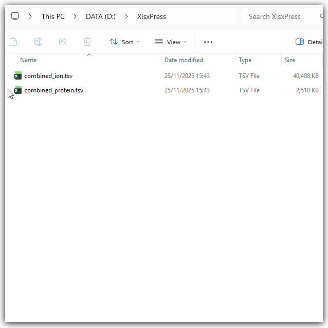

# XlsxPress

[](https://github.com/maxperutzlabs-ms/xlsxpress/actions/workflows/ci.yml)
[](https://pypi.org/project/xlsxpress/)
[](https://pypi.org/project/xlsxpress/)

XlsxPress opens `.csv`, `.tsv`, `.txt` and `.parquet` files in Excel without changing their values. When you open a text file in Excel directly, Excel turns gene names such as `MARCH1` into dates, removes the leading zeros of IDs such as `007`, and reads IDs such as `2310009E13` as numbers. XlsxPress first converts the file into an Excel workbook (`.xlsx`) that keeps these values as text, and then opens the workbook in Excel.

You can use XlsxPress from the context menu of File Explorer on Windows, or from the command line on Windows, macOS and Linux.



## Install

We recommend [uv](https://docs.astral.sh/uv/) because it installs XlsxPress in a separate environment and downloads a suitable Python version if necessary. You do not need administrator rights.

1. Open PowerShell and install uv:

   ```powershell
   powershell -ExecutionPolicy ByPass -c "irm https://astral.sh/uv/install.ps1 | iex"
   ```

2. Close PowerShell and open it again, so that it finds the `uv` command.
3. Install XlsxPress:

   ```powershell
   uv tool install xlsxpress
   ```

4. Add the XlsxPress entries to the context menu of File Explorer:

   ```powershell
   xlsxpress context-menu register
   ```

If PowerShell does not find the `xlsxpress` command in step 4, run `uv tool update-shell`, and then open PowerShell again. For macOS and Linux, the [uv documentation](https://docs.astral.sh/uv/getting-started/installation/) shows how to install uv. The context menu is only available on Windows, so skip step 4 on these systems.

If you prefer pip, you need Python 3.12 or later:

```bash
pip install xlsxpress
```

The context menu entries run XlsxPress from the Python environment in which you registered them. If you delete or move this environment, the entries stop working, so we recommend uv for the context menu.

## Open files from File Explorer

Right-click a `.csv`, `.tsv`, `.txt` or `.parquet` file and select one of these entries:

- **Open in Excel (XlsxPress)** converts the file with your default options and opens the workbook in Excel.
- **Open conversion dialog (XlsxPress)** shows a dialog in which you select the options for this conversion.

On Windows 11, the entries are in the classic context menu. Right-click the file and select **Show more options** to see them.

> [!TIP]
> Hold `Shift` while you right-click a file to open the classic context menu directly.

By default, **Open in Excel (XlsxPress)** converts all rows, formats the header row, and saves the workbook in the temp folder. To change these defaults, use the conversion dialog.

### Use the conversion dialog

Under **Options**, the dialog shows these checkboxes:

- **Format header row** makes the header row bold, wraps long column names, keeps the header row visible while you scroll, and adds filter buttons.
- **Open in Excel after conversion** opens the workbook when the conversion is complete. **Open in Excel (XlsxPress)** ignores this option and always opens the workbook.
- **Convert only the first [N] rows** converts only the first rows of the file. Enter the number of rows in the field. Use this option to look at large files quickly.

Under **Save workbook**, choose where XlsxPress saves the workbook: **Temp folder** or **Next to original**. Workbooks in the temp folder are deleted after some time (see [Where XlsxPress saves workbooks](#where-xlsxpress-saves-workbooks)). XlsxPress never overwrites an existing file.

Click **Convert** to start the conversion. When the conversion is complete, the dialog shows where XlsxPress saved the workbook, and **Show in folder** opens that folder in File Explorer. Warnings and errors appear in the same place. After a conversion, **Convert** becomes **Close**. The dialog closes by itself if it opened the workbook in Excel and has no warnings to show.

To save the current options as your defaults, click **Save as default**. These defaults apply to the dialog and to **Open in Excel (XlsxPress)**. Click **Reset** to set the options back to the built-in defaults; XlsxPress saves them only when you click **Save as default**. **About** explains these buttons and shows where the temp folder and the settings file are.

## Use the command line

The `open` command converts a file into the temp folder and opens the workbook in Excel:

```bash
xlsxpress open data.tsv
```

The `convert` command saves the workbook next to the original file:

```bash
xlsxpress convert data.tsv
```

Both commands accept these options:

| Option | Effect |
|---|---|
| `--nrows N`, `-n N` | Convert only the first `N` rows. |
| `--plain` | Do not format the header row. |
| `--temp` | Save the workbook in the temp folder (`convert` only). |
| `--open` | Open the workbook in Excel (`convert` only). |

Run `xlsxpress --help` or `xlsxpress convert --help` to see all commands and options. The command line uses the cleanup settings of the settings file, but it does not use the defaults of the conversion dialog.

## Where XlsxPress saves workbooks

XlsxPress never overwrites a file. When you convert `data.tsv` next to the original file, the workbook is `data.xlsx`. If `data.xlsx` already exists, XlsxPress adds a number, for example `data-02.xlsx`.

In the temp folder, the name also contains the date and time, for example `data_2026-11-06_142530.xlsx`. Excel cannot open two workbooks with the same name at the same time, so the time stamp lets you open several versions of a file. On Windows, the temp folder is `%LOCALAPPDATA%\xlsxpress\Cache\temp`.

> [!IMPORTANT]
> XlsxPress deletes workbooks in the temp folder after 14 days, and it deletes the oldest workbooks when there are more than 100. It also deletes workbooks that you edited. To keep your changes, save the workbook in a different folder.

XlsxPress keeps your default options and the cleanup limits in a settings file. To see where this file is, run `xlsxpress context-menu status` or click **About** in the conversion dialog. You can change the limits `max_age_days` and `max_files` in the `[cleanup]` section of this file.

## How XlsxPress converts values

XlsxPress reads every column of a text file as text first. A column becomes a number column only if every value in it is a plain number, because only then can Excel show the same value. Otherwise the whole column stays text.

| In the file | In Excel |
|---|---|
| `12`, `-3.5`, `.5`, `1.5e-3`, `1e+05` | Number, if every value in the column is a number |
| `007`, `+5`, `1,5`, `2310009E13`, `MARCH1`, `2024-01-02`, `TRUE` | Text, exactly as in the file |
| `=1+1` | Text, not a formula |
| `NA`, `NaN`, `N/A`, `#N/A`, `null` | Empty cell in a number column; text in a text column |
| `inf`, `-Infinity` | Text `inf` or `-inf`, because Excel has no infinity |

Parquet files store the type of each column, so XlsxPress uses these types. Dates and datetimes become Excel dates, which you can sort and calculate with. Booleans become `TRUE` and `FALSE`, and nested values such as lists become text.

XlsxPress expects text files in UTF-8, or in UTF-16 or UTF-32 with a byte order mark. If a file is not valid UTF-8, XlsxPress reads it as Windows-1252 and shows a warning, so check that special characters such as umlauts are correct. In `.tsv` files the separator is a tab, while for `.csv` and `.txt` files XlsxPress detects the separator (tab, comma or semicolon) from the first lines.

## Limitations

- **Long numbers:** Excel stores only 15 significant digits. A longer integer, such as a 16-digit ID, ends in zeros in Excel.
- **Extreme numbers:** In text files, numbers beyond the range of a double become `inf` (`1e+400`) or `0` (`1e-400`) without a warning.
- **Excel size limits:** A worksheet holds at most 1,048,575 data rows and 16,384 columns. XlsxPress stops with an error for a larger table, so use the preview option to convert only the first rows. Excel also limits a cell to 32,767 characters, so XlsxPress shortens longer text and shows a warning.
- **Dates in Parquet files:** Excel stores times only to the millisecond. Dates before 1 March 1900 become text in ISO 8601 format, because Excel shows these dates incorrectly. Datetimes with a time zone also become text, such as `2024-01-02T10:00:00+01:00`, because Excel has no time zones.
- **Decimal commas:** Values such as `1,5` stay text, because `1,234` means 1.234 in German and 1234 in English.
- **Comment lines:** A text file must start with its header row. Comment or metadata lines above the header cause an error.
- **Context menu:** The context menu and the conversion dialog are only available on Windows.

## Update and uninstall

To update XlsxPress, run:

```bash
uv tool upgrade xlsxpress
```

The context menu entries continue to work after the update. If they stop working, run `xlsxpress context-menu status` to find the problem, and `xlsxpress context-menu register` to fix it.

To uninstall XlsxPress, remove the context menu entries first, because the `xlsxpress` command is not available after the uninstall:

1. Remove the context menu entries:

   ```bash
   xlsxpress context-menu unregister
   ```

2. Uninstall XlsxPress:

   ```bash
   uv tool uninstall xlsxpress
   ```

3. Optional: delete the folders `%LOCALAPPDATA%\xlsxpress` (temp folder) and `%LOCALAPPDATA%\perutzms\xlsxpress` (settings and log file).

### Remove the context menu entries manually

If you uninstalled XlsxPress before you removed the context menu entries, run these commands in PowerShell:

```powershell
foreach ($extension in ".csv", ".tsv", ".txt", ".parquet") {
    foreach ($entry in "XlsxPress.Open", "XlsxPress.Dialog") {
        Remove-Item -Recurse -ErrorAction SilentlyContinue "HKCU:\Software\Classes\SystemFileAssociations\$extension\shell\$entry"
    }
}
```

## Develop XlsxPress

To set up a development environment, clone the repository and install all dependencies with [uv](https://docs.astral.sh/uv/):

```bash
git clone https://github.com/maxperutzlabs-ms/xlsxpress.git
cd xlsxpress
uv sync
```

Run the tests and the code checks with these commands:

```bash
uv run pytest
uv run ruff check .
uv run ruff format --check .
uv run pyrefly check
```

The conversion decisions and the development plan are in [docs/development-plan.md](https://github.com/maxperutzlabs-ms/xlsxpress/blob/main/docs/development-plan.md).

## Feedback

To report a problem or to suggest a feature, open an issue in the [issue tracker](https://github.com/maxperutzlabs-ms/xlsxpress/issues).

## License

XlsxPress is licensed under the [MIT License](https://github.com/maxperutzlabs-ms/xlsxpress/blob/main/LICENSE.md).
